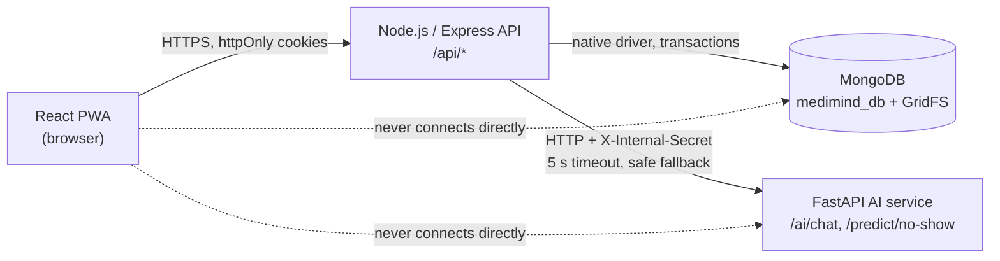
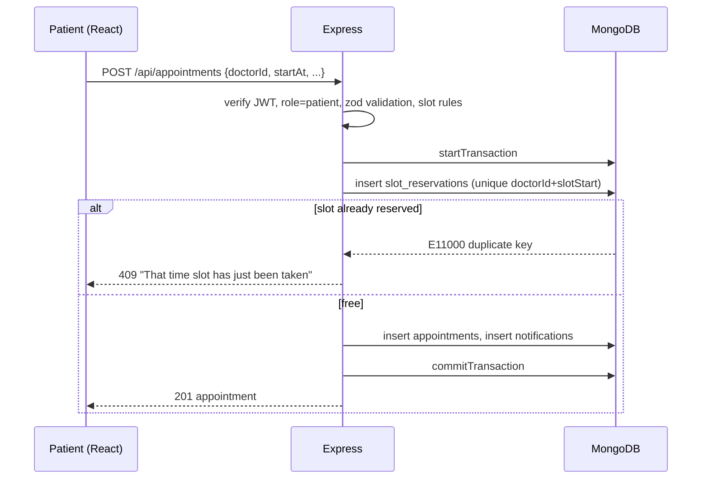
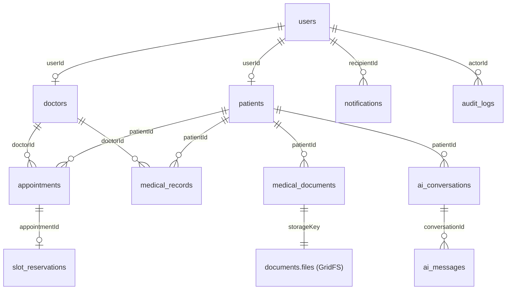

# Architecture

## System



| Responsibility | Lives in | Why |
|---|---|---|
| Identity, JWT sessions, role checks, business rules, public API | Node.js | One enforcement point for authorization |
| Persistence, validation, aggregation, GridFS | MongoDB | The point of the module |
| Retrieval assistant, no-show scoring, guardrails | FastAPI | Isolated, independently testable and deployable; the rest of the app degrades gracefully when it is down |
| Rendering, routing, role-gated screens, PWA | React | Consumes only authorized Node APIs |

Node sends the AI service **only** the question text and an opaque conversation id. No patient identifiers or clinical records leave Node. The AI service logs the mode and score, never the question.

## Request flow: booking an appointment



## Collection relationships



## Running locally

```
npm run setup   one time: MongoDB (Docker), Python virtual environment, demo data
npm start       API :4000, AI service :8000, web app :5173 (the browser only talks to :5173)
```

Configuration lives in `.env` (local development values only; see `.env.example` for what each variable does).
